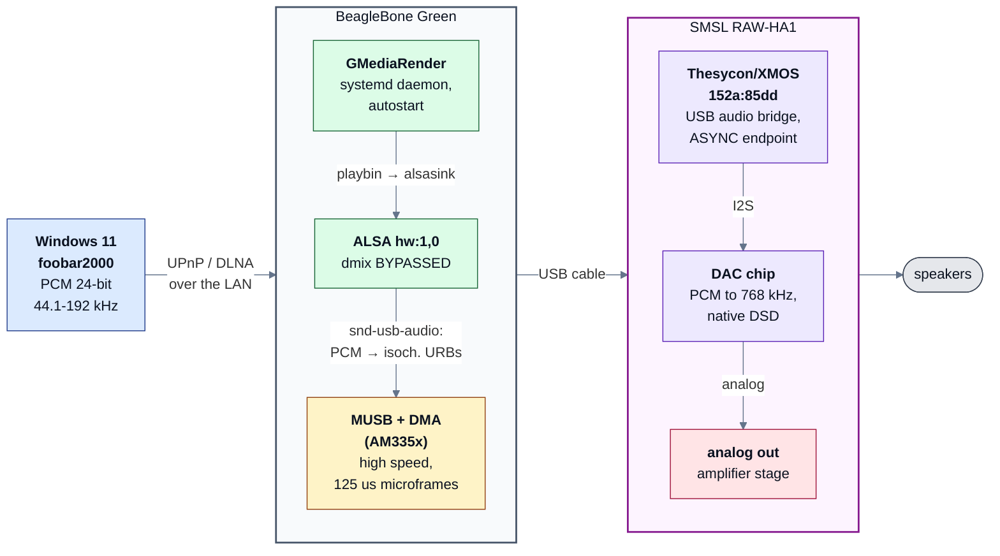
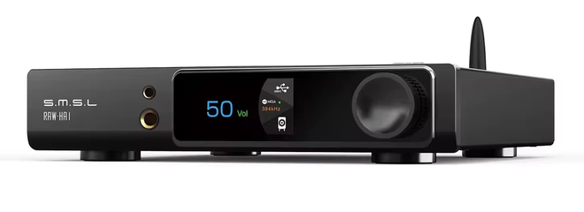

# SMSL RAW-HA1 over USB: signal path and endpoint

How the stream reaches the SMSL RAW-HA1 through its own USB input, and what that
input reports. Kept as the reference for the DAC's USB side.

> The chain in use no longer goes this way: the board feeds an Amanero-type USB card
> and the RAW-HA1 takes coaxial S/PDIF from it. Why, and what that costs, is in
> [ADR-001](adr-001-coax-via-amanero-instead-of-usb.md); the wiring is in
> [audio_transport_power_grounding_map.md](audio_transport_power_grounding_map.md).

## Bypassing the Mixer: The Actual Signal Path

The critical configuration step is routing the audio stream directly to the hardware device, bypassing ALSA's
software mixer (`dmix`) entirely. The `hw:1,0` designator locks the stream to the raw kernel DMA buffer - no
mixing, no volume scaling in software.

Note what `hw:1,0` is *not* here. No I2S DAC is attached to this board. The AM335x McASP peripheral - the SoC's
native I2S engine, brought out on the P9 header - is unused, and onboard audio is stripped via device tree
overlays. The endpoint is an external asynchronous USB device, so the DMA transfer feeds the FIFO of the MUSB
USB 2.0 host controller. I2S does exist in this chain, but inside the DAC, downstream of the USB bridge.

Everything past the USB cable is one sealed unit: the XMOS bridge hands I2S to the DAC chip, and its analog
output drives the amplifier stage. The diagram below shows the inside of it only to place the I2S link where
it actually is.



**The clock lives at the endpoint.** The playback endpoint enumerates as `ASYNC`: the DAC's own oscillator is
master, and the host adapts to its feedback. This is precisely what an S/PDIF link cannot offer - there the
receiver has to recover the clock from the wire with a PLL, and the source's oscillator, however expensive, is
discarded at the far end.

This is enforced in two places working together. The GMediaRender launch flag:

```
-o gst --gstout-audiosink=alsasink
```

And the global ALSA routing in `/etc/asound.conf` which maps `pcm.!default` to `hw:1,0`. The alsasink picks
up the default device from there — no device hardcoded in the flags, no dmix in the path.

Any `plughw:` or `default:` in `/etc/asound.conf` silently re-enables dmix and destroys bit-perfect integrity.

## The endpoint: SMSL RAW-HA1



It carries a **Thesycon/XMOS bridge, `152a:85dd`**. On kernel 5.10 `stream0`
describes it in far more detail than the factory kernel ever did:

```bash
cat /proc/asound/card1/stream0

```

    SMSL SMSL USB AUDIO at usb-musb-hdrc.1-1, high speed : USB Audio

    Playback:
      Interface 1
        Altset 1
        Format: S32_LE
        Rates: 44100, 48000, 88200, 96000, 176400, 192000, 352800, 384000, 705600, 768000
        Bits: 32
        Endpoint: 0x01 (1 OUT) (ASYNC)
        Sync Endpoint: 0x81 (1 IN)
        Implicit Feedback Mode: No
        Data packet interval: 125 us
      Interface 1
        Altset 2
        Format: S32_LE
        Bits: 24
      Interface 1
        Altset 3
        Format: SPECIAL DSD_U32_BE
        Bits: 32
        DSD raw: DOP=0, bitrev=0

Three things there are worth reading carefully. `Sync Endpoint: 0x81` is the
feedback endpoint stated explicitly - the factory kernel only ever printed
`Feedback Format = 16.16` and left the rest implicit. Altset 2 reports **24 bits
inside a 32-bit slot**, which is why ALSA offers only `S32_LE` in both. And
altset 3 is **native DSD**, which this DAC has in hardware.

What `lsusb -v` adds, in short:

| bridge            | Thesycon/XMOS `152a:85dd`       |
|:------------------|:--------------------------------|
| formats ALSA sees | `S32_LE` only                   |
| `bSubslotSize`    | **4 bytes in every altsetting** |
| bits carried      | 24 or 32 in a 32-bit slot       |
| top rate          | **768 kHz**                     |
| DSD               | **native, `DSD_U32_BE`**        |
| `wMaxPacketSize`  | **776 bytes**                   |
| host volume       | none at all                     |

The last row matters in practice: the device exposes no mixer element, so there
is no digital attenuation on the host to get wrong, and `amixer` finds nothing
to set.

The 776-byte packet is the device declaring what it needs at 768 kHz, and the
host reserves that whether or not it is used. On the factory kernel that
reservation looked like the reason this DAC behaved worse than a lesser one; on
5.10 it runs at ratio 1.0000 and the reservation costs nothing.

### DSD without a DSD decoder

The DAC's native DSD altsetting has never been reached from any source here.
What does work is **DoP**, and DoP is not DSD as far as this board is concerned:
it is 24-bit PCM at 352.8 kHz with a marker in the top byte, which the DAC
recognises and unwraps. GStreamer carries it without knowing what it is, which
is why DSD128 plays on the factory image whose GStreamer 1.8.3 has no DSD
decoder at all.

Playing a DSF, the amplifier's display reads `DoP  5.6448 MHz` and the board
reports:

    rate        352800 Hz, S32_LE, period 3528 / buffer 70560
    Momentary freq = 352800 Hz (0x2c.1998)
    delivered   352775 frames/s   ->  -69 ppm
    USB         2 822 400 bytes/s
    network     2 986 000 bytes/s from foobar2000

That is eight times the data rate of CD and it arrives intact. Two cautions.
DoP costs exactly twice the bandwidth of native DSD, since every DSD bit rides
inside a PCM frame with the marker overhead. And DoP is fragile in a way plain
PCM is not: the marker pattern is what identifies the stream, so a single
corrupted sample makes the DAC lose sync, and a DAC that loses sync either mutes
or plays the bits as PCM - a full-scale noise burst. Any software volume applied
anywhere in the chain destroys the markers outright, so the renderer must be at
100 and nothing may resample.

Whether the player sends DoP or converts DSD to PCM itself is decided on the PC.
Both work here; `hw_params` says which is happening - `352800` for DoP, `44100`
for a conversion.
