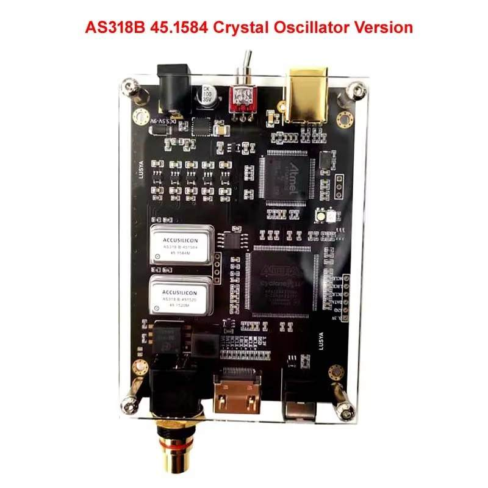
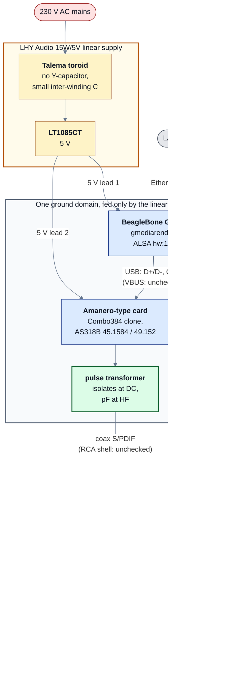

# Audio Transport Power & Grounding Map

Power distribution and grounding of the chain in use: **BeagleBone Green → Amanero-type USB card →
coaxial S/PDIF → SMSL RAW-HA1**. Why coax and not the RAW-HA1's own USB input is recorded in
[ADR-001](adr-001-coax-via-amanero-instead-of-usb.md); the DAC's USB side is described in
[SMSL-RAW-HA1.md](SMSL-RAW-HA1.md).

The setup was found by trial and listening. This document explains why it works; it is not a
derivation that came first.

**The one rule:** the board and the card are powered from the same linear supply. Power the board
from a switching supply - let alone from a PC USB port - and the sound is gone, coax and transformer
notwithstanding.

---

## 1. Power: one linear supply for both boards

A single linear supply - **LHY Audio 15W/5V**, Talema toroidal transformer, LT1085CT regulator. It has
no Y-capacitor from mains to the output side, which a typical switching supply has (1-2 nF,
roughly 70-150 µA of 50 Hz leakage onto the output at 230 V).

**Less leakage, not none.** A toroid has its own primary-to-secondary capacitance, a few hundred pF,
which still couples some 50 Hz onto the secondary - several times less than through a Y-capacitor.
That difference is what is audible; a switching supply on either board brings the full leakage back.

Two 5 V leads leave the supply's output terminals:

1. **BeagleBone Green** - 5 V barrel input.
2. **Amanero-type card** - its own DC jack, marked `DC 5V-9V`.

No local LC filter is fitted on the card's lead. If one is ever tried, use a polymer capacitor, not
tantalum: a tantalum on a 5 V rail that gets plugged live tends to fail short.

### It is not a star, and that is fine

The ground leaves the supply twice - to the board and to the card - and the board and the card are
joined again through the USB ground. That is a loop by definition. It is harmless because nothing
drives it: all of it sits on the secondary of one transformer, with no mains and no second supply
inside it. The point is not the absence of loops but that **there is only one source of leakage, and
a small one**.

---

## 2. USB between the board and the card

* **`D+`, `D-`:** the audio stream. Differential signalling protects the data, not the grounds - the
  data arrive intact either way; what matters for sound is what the ground carries.
* **`GND` and shell:** join the board and the card into one ground domain, fed only by the linear
  supply.
* **`+5V` (VBUS):** the card has its own DC jack and a toggle next to it. Whether the board's VBUS is
  still connected to the card **has not been checked**.

---

## 3. Coaxial output: transformer isolation

The card's S/PDIF output goes through a pulse transformer, which breaks the DC connection between the
transport's ground and the RAW-HA1.

**A transformer isolates at DC only.** At high frequency its inter-winding capacitance (pF to tens of
pF) passes common-mode current from the transport's ground into the coax and on into the DAC. That is
why the transformer alone is not enough and section 1 matters: with the board on a switching supply,
its leakage rides the shared ground into the card and crosses the transformer through that
capacitance. Clean ground upstream and the transformer work only together.

**Unchecked: is the RCA shell isolated?** If the RCA shell on the card is tied to its ground, the coax
shield carries the transport's ground straight into the DAC and the transformer isolates the centre
conductor only. Check with a multimeter, continuity between the RCA shell and the USB shell/GND on the
card. Tracked in [ADR-001](adr-001-coax-via-amanero-instead-of-usb.md).

Toslink would isolate completely, with no capacitance at all, at the cost of more jitter. Coax through
a transformer is the compromise chosen here.

---

## 4. Ethernet: the path the scheme does not cover

The board's only other connection to the outside world is Ethernet. Use **unshielded (UTP)** cable. A
shielded (STP) cable into an earthed switch ties the board's ground - and through USB the card's - to
mains earth, and the whole domain stops floating.

---

## 5. Clocks: what they do over coax

The card is a clone built to the Amanero Combo384 design (Atmel + CPLD), not an original Amanero. It
carries two Accusilicon AS318B oscillators, 45.1584 and 49.152 MHz, in metal cans.

* **Over coax these oscillators clock the S/PDIF transmitter, not the DAC.** The RAW-HA1's receiver
  recovers the clock with its PLL, and the DAC chip runs from that, on the RAW-HA1's own board and
  supply.
* What they still contribute: slow jitter below the receiver PLL's corner passes through, and a good
  source lowers it. Fast jitter is cut by the PLL, which adds its own noise. So the result is somewhat
  better with these oscillators, but never better than the RAW-HA1's receiver.
* "0.1 ppm" in the listing is frequency accuracy, not jitter, and is irrelevant for audio.
* The only way these oscillators clock a DAC directly is I2S over the card's HDMI output. The RAW-HA1
  has no such input (its HDMI is, as far as the board markings tell, ARC - S/PDIF again).

What coax costs compared with the DAC's USB input: the asynchronous clock (the DAC's own oscillator
as master), and everything above 192 kHz - so DoP stops at DSD64; DSD128 over DoP needs 352.8 kHz.

---

## 6. Topology

