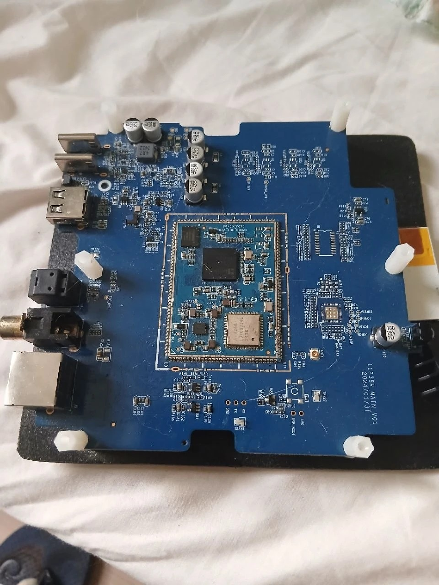

# Hardware Audit: FiiO SR11 (`1123SR MAIN V01`) vs. BeagleBone Green + Amanero

## Why it is not a hi-fi transport, in short

The SR11 is a network player that has an S/PDIF output, not a digital transport built around one:

1. **No clock of its own for audio.** No audio oscillator on the board; the S/PDIF clock is, by all
   signs, synthesised by the SoC's PLL from the processor's crystal, next to the Wi-Fi radio. Its
   slow jitter goes straight through the DAC's receiver PLL.
2. **Switching noise at home.** A buck converter on the same board and ground as the SoC and the
   outputs.
3. **The coax is, by all signs, not isolated.** No transformer seen at the RCA jack, so the SR11's
   ground - converter, radio, adapter - goes down the shield into the DAC.

Each of the three is something the chain in use was put together to avoid. Points 1 and 3 are read
off the photo and still need the checks below (section 4, section 5).

An inspection of the **FiiO SR11** mainboard (`1123SR MAIN V01`, dated `2024/01/31`), compared with
the chain in use: **BeagleBone Green → Amanero-type card (Combo384 clone) → coax S/PDIF → SMSL
RAW-HA1** ([grounding map](audio_transport_power_grounding_map.md),
[ADR-001](adr-001-coax-via-amanero-instead-of-usb.md)).

**What it rests on:** one photo of the top side of the board. The underside, the space under the
module's shield and the SR11's own power adapter were not looked at. Below, *seen* is what is on that
photo; *inferred* is what follows from it and still needs checking.

By ear, on the same RAW-HA1, the SR11 over coax is the thinnest in the bass of the three paths
tried (SR11 coax < Valera USB < Valera via the card). What follows is consistent with that, but does
not prove the cause.

---

## 1. Clocking

* **Seen:** the SR11 is built around a system-on-module (SoC, memory, Wi-Fi/BT module) soldered onto
  a carrier board. On the top side there is no part that looks like a dedicated audio oscillator
  (22.5792 / 24.576 MHz or 45.1584 / 49.152 MHz) - neither near the module nor near the optical and
  coax outputs. The small crystals visible on the module are, by their place, the SoC's and the
  radio's references (typically 24 MHz).
* **Inferred:** the I2S and S/PDIF clocks are synthesised inside the SoC by a fractional-N PLL from
  the processor's crystal, on the same die and supply as the Wi-Fi/BT radio. Such synthesis has slow
  phase noise (wander), below the loop bandwidth of the RAW-HA1's S/PDIF receiver PLL, so it passes
  into the DAC chip's clock.
* **The card:** two dedicated Accusilicon AS318B oscillators, 45.1584 and 49.152 MHz, one per rate
  family, no fractional synthesis. Over coax they too reach the DAC chip only as slow jitter through
  the receiver PLL - but that slow jitter is lower.

---

## 2. Power

* **Seen:** at the SR11's power input, upper left, a switching buck converter (a `4R7` inductor with
  electrolytic and ceramic capacitors) on the main board, sharing ground with the module and the
  digital outputs. Whatever feeds the SR11, the board generates switching noise of its own.
* **Not checked:** the SR11's own power adapter. If it is a switching supply with a Y-capacitor, its
  50 Hz leakage sits on the SR11's ground - and with the coax not isolated (section 3), on the
  RAW-HA1's too. By the grounding map's own logic this may weigh more than the synthesised clock.
* **The chain in use:** Valera and the card are fed from one LHY Audio 15W/5V linear supply
  (`LT1085CT`), the card from its own 5 V lead. Not isolated: the card shares ground with Valera
  through USB. Whether the card has switching converters of its own has not been checked.

---

## 3. Coax output isolation

* **Seen:** around the RCA jack (between the Toslink port and the Ethernet jack) no SMD pulse
  transformer on the top side, only small passive footprints.
* **Inferred:** coupling through a resistor network and a series capacitor, as usual in cost-optimised
  streamers, with the RCA shell tied straight to board ground. Then the noise of the on-board buck
  converter, the radio and the adapter goes down the coax shield into the RAW-HA1's ground - what
  the card's transformer prevents in the chain in use.
* **Ethernet:** both boxes have shielded metal RJ-45 jacks - the BeagleBone too. What decides is the
  cable: STP into an earthed switch ties either box's ground to mains earth. Valera runs on UTP
  (Vention IBEBH); the same rule applies to the SR11.

---

## 4. Multimeter check

SR11 unplugged from mains and from every cable.

1. **RCA shell to board ground** (USB-A shell, Ethernet jack shell, any GND test point). This is the
   deciding reading.
2. **RCA centre pin to RCA shell.**

| reading 1 (shell to ground) | reading 2 (centre to shell) | what it is                                                                    |
|:----------------------------|:----------------------------|:------------------------------------------------------------------------------|
| open, megaohms              | below 1 Ω                   | a transformer: reading 2 is its secondary winding, and the shell is isolated |
| below 1 Ω                   | about 75-100 Ω              | a resistor network, no transformer; the shield is board ground               |
| below 1 Ω                   | open                        | a resistor network with a series capacitor, no transformer                   |

---

## 5. The experiment the SR11 offers: Toslink against coax

The SR11 has an optical output. Toslink removes the ground connection completely and leaves the
clocking exactly as it is - so playing the same material over the SR11's Toslink and over its coax,
into the same RAW-HA1, separates the two causes:

* **Toslink clearly better than coax** - the ground was deciding (section 3, and the adapter in
  section 2).
* **Both the same** - the clocking decides (section 1).

Compare by ear and by the tone measurement of [ADR-002](adr-002-input-comparison-by-spl-meter.md).

---

## 6. Summary

| Parameter              | FiiO SR11 (`1123SR MAIN V01`)                                       | BBG + Amanero-type card (chain in use)                                  |
|:-----------------------|:--------------------------------------------------------------------|:------------------------------------------------------------------------|
| **Audio clocks**       | no audio oscillator seen; inferred SoC fractional-N PLL             | two dedicated **Accusilicon AS318B**, 45.1584 / 49.152 MHz              |
| **Power**              | on-board buck converter (`4R7`) shared with SoC and Wi-Fi; adapter not checked | one **LHY Audio** linear supply, the card on its own 5 V lead; ground shared with Valera via USB |
| **Coax isolation**     | no transformer seen on the top side; check per section 4            | **pulse transformer**; RCA shell continuity still unchecked (ADR-001)   |
| **Ethernet**           | shielded RJ-45 jack; cable decides                                   | shielded RJ-45 jack on the BeagleBone, **UTP** cable (Vention IBEBH)    |
| **Optical output**     | yes - the ground-free comparison of section 5                        | none on the Amanero-type card                                           |
